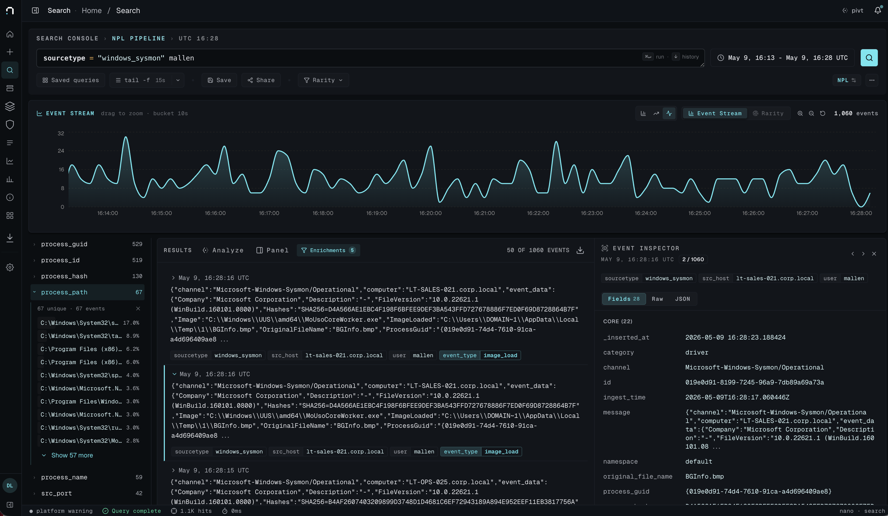
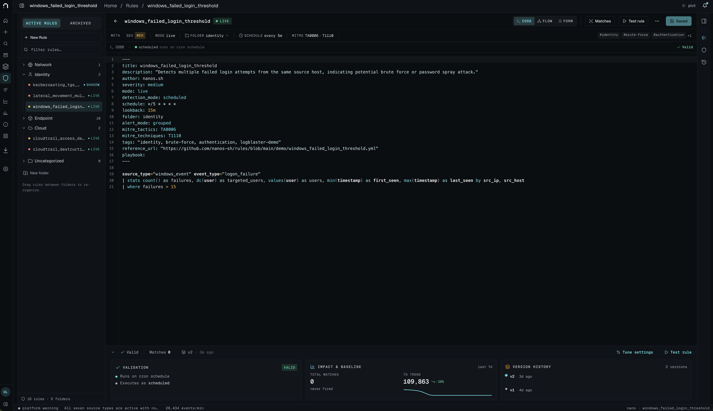
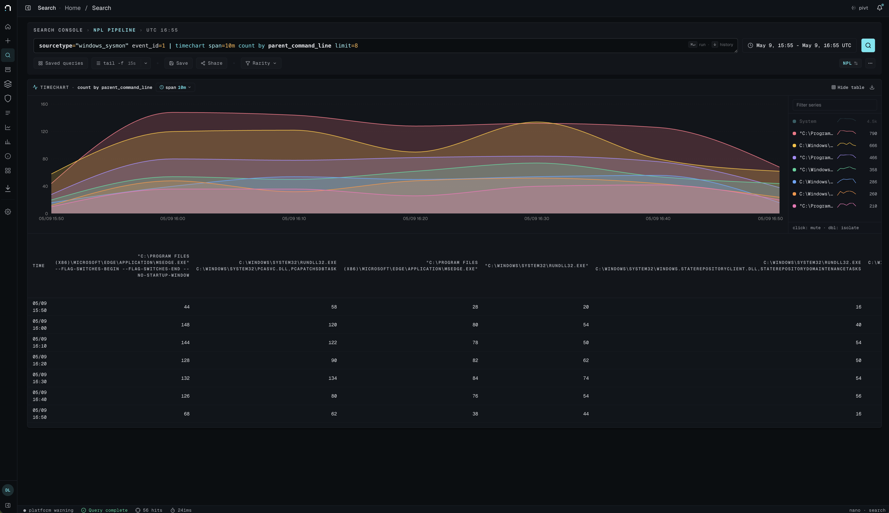
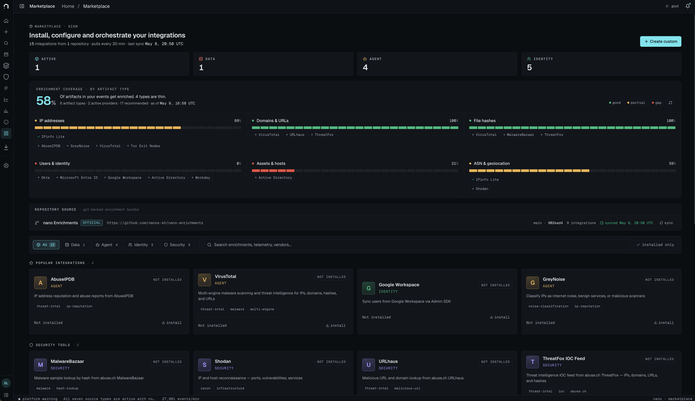

<p align="center">
  <picture>
    <source media="(prefers-color-scheme: dark)" srcset="./logo_white.svg">
    <source media="(prefers-color-scheme: light)" srcset="./logo_blue.svg">
    
  </picture>
</p>

<p align="center">
  A SIEM you run on your own servers. It collects your security logs, lets you
  search them, and runs detection rules that raise alerts.
</p>

<p align="center">
  <a href="./LICENSE"></a>
  <a href="https://discord.gg/5rk8bwmkj7"></a>
</p>

<p align="center">
  <a href="https://nano.rs">Website</a>
  ·
  <a href="https://nano.rs/docs/">Docs</a>
  ·
  <a href="https://discord.gg/5rk8bwmkj7">Discord</a>
  ·
  <a href="https://nano.rs/pricing">Pricing</a>
</p>

<p align="center">
  
</p>

---

nano is a SIEM (security information and event management system). It takes
in logs from your firewalls, endpoints, cloud accounts and apps, stores them in
ClickHouse, and lets you hunt through them with nPL, a short piped query
language. Detection rules run on a schedule and turn matches into alerts.

For example, this search finds IP addresses with more than 10 failed logins
(class 3002 is authentication, activity 1 is a logon, status 2 is a failure):

```
class_uid=3002 activity_id=1 status_id=2 | stats count by src_endpoint.ip | where count > 10
```

This repository is **nano Open**, the free open-core edition, licensed under
AGPL-3.0. The **Paid** tier adds cases, automation, AI and high availability.
See [Open vs Paid](#open-vs-paid).

## Quick start

On a Linux server with Docker, run this as a normal user in the `docker` group
(not with `sudo`):

```sh
curl -fsSL https://get.nano.rs | bash
```

<p align="center">
  <a href="https://youtu.be/cyL6lkPZfbw">
    
  </a>
</p>

<p align="center">
  <em>One command, about 45 seconds, and you have a working nano. <a href="https://youtu.be/cyL6lkPZfbw">Watch on YouTube</a></em>
</p>

On a Mac (for a trial), the built-in bash is too old. Install a newer one with
Homebrew and run the installer with it:

```sh
brew install bash
curl -fsSL https://get.nano.rs | "$(brew --prefix)/bin/bash"
```

The installer clones this repository to `~/nano`, generates secrets, pulls the
images from `ghcr.io/nano-rs`, and starts the stack: PostgreSQL, ClickHouse,
Vector, the nano services and nginx. It then helps you create the first admin
account. Open `http://localhost` (or your server's name) when it finishes.

Next step: [set up your first feed](https://nano.rs/docs/getting-started/first-feed/).

**Install with no prompts.** Download the installer, put the answers in front
of `bash`, and add `--non-interactive`:

```sh
curl -fsSL https://get.nano.rs -o install.sh
NANO_ADMIN_EMAIL=you@example.com \
NANO_ADMIN_PASSWORD='<your password>' \
NANO_BASE_URL=https://nano.example.com \
bash install.sh --non-interactive
```

Replace `<your password>` with your own. It needs 12 or more characters, with
an uppercase letter, a lowercase letter, a digit and a special character.
Every other question takes its default. `NANO_ADMIN_NAME` is optional (it
defaults to `Admin`). If a required value is missing or invalid, the installer
lists it and stops before it changes anything. To see every question and its
variable, run `bash install.sh --help`.

**If the install stops early.** Until the first admin exists, creating one
needs the setup token the installer wrote to `~/nano/.env`
(`NANO_SETUP_TOKEN`). Run `./install.sh` again, or open the web UI and enter
the token on the setup page.

## A quick look

<p align="center">
  
</p>

<p align="center">
  <em>The detection rule editor. Rules move from Staging to Live to Alerting, with MITRE ATT&amp;CK tags, a baseline impact check, validation and version history.</em>
</p>

<p align="center">
  
</p>

<p align="center">
  <em>Hunting with nPL: a timechart of process creation split by parent command line, with the results table underneath.</em>
</p>

<p align="center">
  
</p>

<p align="center">
  <em>The Marketplace: a catalog of enrichment providers for threat intel, identity, assets and geolocation.</em>
</p>

## Requirements

- **Software:** Docker with Compose v2, bash 4.4 or newer, Python 3.9 or newer
  (`python3`), git, openssl and curl.
- **Smallest host:** 2 vCPU, 8 GB RAM and 40 GB free disk, with the enrichment
  feeds turned off (`PLATFORM_FEEDS_AUTO_UPDATE=false`). With the feeds on,
  which is the default, you need 16 GB RAM.
- **Up to 5 GB of logs a day:** plan for 4 vCPU and 16 GB RAM.
- **Bigger installs:** see
  [Install with Docker Compose](https://nano.rs/docs/getting-started/install-compose/)
  for sizing by daily volume. One server handles up to about 100 GB a day.

The installer checks the host before it asks you anything and stops on a host
that is too small. It also sizes ClickHouse, PostgreSQL and Vector to the CPU
and RAM it finds.

The enrichment feeds (IP location, Tor exit nodes and ThreatFox) need about
6 GB of memory for ClickHouse. If ClickHouse has less, the feeds don't load:
events still arrive, but without location data, and SIEM Health shows the
problem.

## Send logs in

nano uses [Vector](https://vector.dev) to receive and parse logs. You can send
logs in these ways:

| Method | Where it listens | Notes |
|---|---|---|
| HTTP (JSON or NDJSON) | `http://<host>/ingest` or port 8080 | Ingest token in `Authorization: Bearer` |
| Splunk HEC | port 8088, `/services/collector/event` | Works with any HEC sender |
| OpenTelemetry (OTLP) | `http://<host>/otlp/v1/logs` (also `traces` and `metrics`); raw gRPC 4317 and HTTP 4318 | The `/otlp` path needs an ingest token and OTLP/HTTP protobuf (`Content-Type: application/x-protobuf`); JSON is refused. The raw ports check no token and listen on 127.0.0.1 unless you open them |
| Vector to Vector | port 6000 | Needs a client certificate per sender |
| Pull from a queue or bucket | Kafka, AWS S3 and SQS, GCP Pub/Sub, Azure Event Hubs | Set up per log source |
| Pull from a vendor API | for example Okta System Log or Google Workspace | Runs in the `connector-runner` service, which is off by default. Start it once with `docker compose -f docker-compose.opensource.yml --profile pull-feeds up -d connector-runner` |
| Syslog | | Ships turned off, and no syslog port is published. Send syslog to a collector that forwards over HTTP or HEC, or turn on Vector's syslog source and publish its port in the compose file |

Each ingest token belongs to one log source, so an event always lands in the
source its token was made for. Fluentd, Fluent Bit, Cribl and other log
shippers work through the HTTP, HEC or OTLP inputs.

See [Integrations](https://nano.rs/docs/integrations/) for setup guides.

## How events are stored

nano stores every event in [OCSF](https://nano.rs/docs/concepts/ocsf-schema/)
(the Open Cybersecurity Schema Framework, version 1.9), an open standard for
security event fields. A source IP is always `src_endpoint.ip` and a user is
`actor.user.name`, whichever product the log came from. Fields a parser didn't
map are kept under `unmapped`, and the raw event is kept too.

ClickHouse keeps events for 365 days by default (`NANO_RETENTION_DAYS`).

Older installs may use UDM, nano's earlier flat schema (`src_ip`, `user`).
It is kept only so those installs can move to OCSF. See
[Migrating from legacy field names](https://nano.rs/docs/reference/migrating-from-udm/).

## What an Open install connects to

These are the only outside hosts an Open install talks to on its own.

| Host | What for | When | How to turn it off |
|---|---|---|---|
| `get.nano.rs` | Serves `install.sh` | When you run the one-line install | Download `install.sh` once and run it from a file |
| `github.com` | Clones and updates this repository | Install and re-runs of the installer | Set `NANO_REPO_URL` to your own copy |
| `api.github.com`, `raw.githubusercontent.com` | Fetches the image list (`images.lock`) for another release | Only when you pin `NANO_VERSION` to a release other than the one checked out | Don't pin `NANO_VERSION`, or set `NANO_REPO_URL` to a non-GitHub copy |
| `ghcr.io`, `pkg-containers.githubusercontent.com` | nano's own images and its Vector build (the second host serves the image layers) | Install and upgrade | Use a registry mirror, or pull the images ahead of time |
| Docker Hub: `registry-1.docker.io`, `auth.docker.io`, `production.cloudfront.docker.com` | ClickHouse, PostgreSQL, nginx and Valkey images (sign-in token and image layers) | Install and upgrade | Same as above |
| `api.nano.rs` | Signed content updates: the official parsers, rules, enrichment catalog and MITRE ATT&CK data | On by default, checks hourly | `CONTENT_CHANNELS_AUTO_UPDATE=false` |
| `api.nano.rs` | Signed enrichment feeds: IPinfo Lite (IP location and network owner), ThreatFox and Tor exit nodes | On by default, checks hourly | `PLATFORM_FEEDS_AUTO_UPDATE=false` |
| Cloudflare R2 (`*.r2.cloudflarestorage.com`) | Where the two signed bundles above are downloaded from | Only when a newer bundle exists | Turns off with the two settings above |

Every bundle is signed, and nano checks the signature before it installs
anything. You can also point both updates at your own copy
(`CONTENT_CHANNELS_URL`, `PLATFORM_FEEDS_URL`).

**Running without internet access.** After install, set both
`*_AUTO_UPDATE` settings to `false` in `~/nano/.env` and recreate the
containers from `~/nano` with
`docker compose -f docker-compose.opensource.yml -f docker-compose.tls.yml up -d`
(leave out the TLS file if you serve plain HTTP). Then copy bundles in by hand. On a connected machine, the
newest feed bundle is named by `https://api.nano.rs/api/feeds/v1/open/current`
and each content bundle by
`https://api.nano.rs/api/content/v1/open/<channel>/current` (for example
`rules.main`); download the `bundle_url` each one returns. Make API keys under
**Settings > Access Control > API Keys**, then from `~/nano`:

```sh
# Enrichment feeds (API key with the enrichments:configure permission)
NANO_URL=https://nano.example.com NANO_API_KEY_FILE=feeds.key \
  scripts/nano-feeds update --file bundle.nanfeed

# Content (API key with the settings:system permission). The key is read from
# a file into curl's -H @file form, so it never shows up in your shell history
# or the process list.
printf 'X-API-Key: %s\n' "$(cat content.key)" > content.hdr && chmod 600 content.hdr
curl -X POST -H @content.hdr \
  -H 'Content-Type: application/octet-stream' --data-binary @rules.nancontent \
  https://nano.example.com/api/content/channels/import
rm -f content.hdr
```

Full air-gapped installs (no internet during install either) are a Paid
feature.

**What nano does not do.** It sends no usage data, no telemetry and no crash
reports. Error reporting only runs if you set `NANO_SENTRY_DSN` yourself, and
nano ships with none. The web UI loads no outside scripts or fonts.

**Connections you set up yourself.** Pull feeds (Kafka, cloud queues, vendor
APIs), identity providers you turn on in the marketplace (Active Directory,
Entra ID, Okta, Google Workspace, Workday), Git repositories you add, and
webhooks connect only to the hosts you give them.

The Paid tier adds a license check through `api.nano.rs`, images from nano's
private registry, and any AI provider you pick.

## Open vs Paid

**Open** is free and is this repository. **Paid** is one licensed build that
also runs on your own servers. See [pricing](https://nano.rs/pricing) for
details.

| | Open (free) | Paid |
|---|:---:|:---:|
| Log intake: HTTP, HEC, OTLP, Vector, Kafka, S3/SQS, Pub/Sub, Event Hubs, API pull feeds | Yes | Yes |
| Parsers, OCSF mapping and pipelines (filter, reshape and route events) | Yes | Yes |
| Search with nPL, dashboards and scheduled reports | Yes | Yes |
| Detection rules, alerts, retro hunts and MITRE ATT&CK coverage | Yes | Yes |
| Rule and parser repositories synced from Git | Yes | Yes |
| Enrichment feeds, lookup tables and prevalence (how rare a value is) | Yes | Yes |
| Local users, MFA, roles and per-source access | Yes | Yes |
| SIEM Health, audit log and backups | Yes | Yes |
| Cases, notebooks and incidents | No | Yes |
| Automation (SOAR): flows, actions, approvals and playbooks | No | Yes |
| Hunts: AI-run threat hunts, leads and escalations | No | Yes |
| pivt, the built-in AI assistant, and the AI helpers for rules, parsers and searches | No | Yes |
| Agent Lane: a fast read-only lane for outside AI agents | No | Yes |
| Risk scoring and risk watchlists | No | Yes |
| Rule auto-tuning | No | Yes |
| IOC lists, threat intel and custom enrichments | No | Yes |
| Evidence packs for auditors | No | Yes |
| SSO (OIDC: Okta, Entra ID, Google) and SCIM user sync | No | Yes |
| Moving old data to object storage (AWS S3, S3-compatible, Google Cloud Storage or Azure Blob) | No | Yes |
| High availability across three or more servers | No | Yes |
| Kubernetes (Helm chart) | No | Yes |
| Air-gapped installs | No | Yes |

An Open install can move to the Paid tier in place: run `scripts/nano convert
--to enterprise` with the Paid package. To ask about a license, email
[hello@nano.rs](mailto:hello@nano.rs). See
[Deployment models](https://nano.rs/docs/concepts/deployment-models/) for the
details.

**Deploy with your coding agent.** The [`nano-deploy`](skills/nano-deploy/SKILL.md)
skill lets Claude Code, Codex or another coding agent size, install and run
the Paid tier on your hosts. It checks the hosts first, asks before every change and
never prints secrets. See [`skills/`](skills/README.md).

## Serve HTTPS

The default stack serves plain HTTP on port 80. To serve HTTPS, put your
certificate chain and private key here:

```
config/nginx/ssl/fullchain.pem   # certificate (leaf + intermediates)
config/nginx/ssl/privkey.pem     # private key
```

Any source works: Let's Encrypt, your own CA, or a self-signed pair for testing
(`./config/nginx/generate-ssl.sh`). Then run the installer again from `~/nano`
with your HTTPS address and the TLS file:

```sh
cd ~/nano
NANO_BASE_URL=https://nano.example.com NANO_COMPOSE_OVERLAYS=docker-compose.tls.yml ./install.sh
```

The installer checks the certificate, saves both settings in `.env`, turns off
plain-HTTP mode (`NANOSIEM_DEV_MODE=false`) so login cookies are marked
`Secure`, and restarts the stack. nginx then serves HTTPS on 443 and sends
port 80 to 443. See [`config/nginx/ssl/README.md`](./config/nginx/ssl/README.md).

## How it fits together

```
 log senders
     |
     v
+----------+                 +-------------+
|  Vector  | --------------> | ClickHouse  |  events
| (parse)  |                 +-------------+
+----------+                        ^
                                    |
+------------+   +----------+   +--------------+
| PostgreSQL |<--| nano-api |   | nano-search  |
| rules,     |   |  :3000   |   |    :3002     |
| alerts,    |   +----------+   +--------------+
| users,     |        ^                ^
| audit      |        |                |
+------------+   +-------------------------+
                 |   nano-web (browser)    |
                 +-------------------------+
```

- **Vector** receives logs, parses them into OCSF and writes them to ClickHouse.
- **nano-api** handles rules, alerts, users and settings. Its API docs are at
  `/swagger-ui/` (sign in first).
- **nano-search** runs searches and field stats.
- **nano-jobs** runs scheduled detections and Git repository syncs.
- Both databases are required. nano won't start if it can't reach either one.

## Build from source

Use the [Quick start](#quick-start) if you just want to run nano. To work on
the code you need Rust 1.100 or newer (`rust-toolchain.toml` pins it), Node 22
or newer, PostgreSQL 16 to 18 and ClickHouse 26.3 LTS or newer. See
[CONTRIBUTING.md](./CONTRIBUTING.md) for the steps.

## Docs

- [Set up your first feed](https://nano.rs/docs/getting-started/first-feed/)
- [Install with Docker Compose](https://nano.rs/docs/getting-started/install-compose/)
- [Integrations](https://nano.rs/docs/integrations/): every way to send logs in
- [Search commands (nPL)](https://nano.rs/docs/search-commands/)
- [Detections](https://nano.rs/docs/user-guide/detections/)
- [OCSF fields](https://nano.rs/docs/reference/ocsf-fields/)
- [Agent skills](https://nano.rs/docs/agents/skills/) for coding agents

## Related repositories

- [parsers](https://github.com/nano-rs/parsers): Vector parsers for common log
  sources
- [rules](https://github.com/nano-rs/rules): detection rules you can import
- [nano-enrichments](https://github.com/nano-rs/nano-enrichments): the
  enrichment catalog behind the marketplace
- [nanodac](https://github.com/nano-rs/nanodac): manage detection rules as code
  in Git

## Community and contributing

- **Star this repo** if nano is useful to you. It helps other people find it.
- Ask questions and share what you built on [Discord](https://discord.gg/5rk8bwmkj7).
- See [open issues](https://github.com/nano-rs/nano/issues) for what people are working on.
- Report bugs and request features with the
  [issue templates](./.github/ISSUE_TEMPLATE/).
- Contributions are welcome under a contributor license agreement (CLA). See
  [CONTRIBUTING.md](./CONTRIBUTING.md) and [.github/ICLA.md](./.github/ICLA.md).
  nano is open core, so the CLA gives nano, LLC the right to also use your
  change in the paid edition.

## Security

Found a vulnerability? Please don't open a public issue. Email
[security@nano.rs](mailto:security@nano.rs). See [SECURITY.md](./SECURITY.md)
for the full policy.

## License

The code in this repository is licensed under the GNU Affero General Public
License v3.0 or later. See [LICENSE](./LICENSE) and
[LICENSING.md](./LICENSING.md). If AGPL doesn't fit how you use nano, a
commercial license is available from [hello@nano.rs](mailto:hello@nano.rs).
