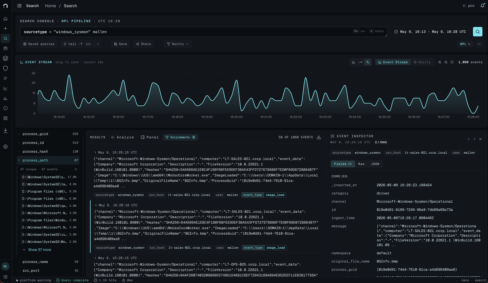
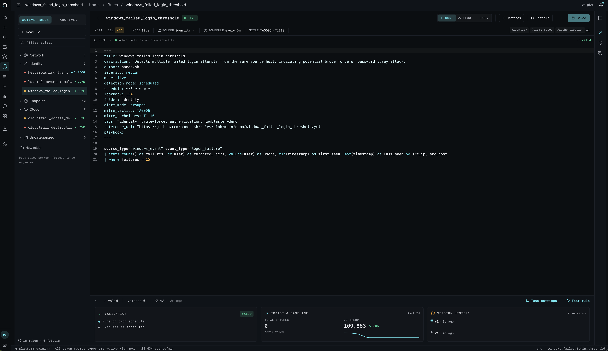
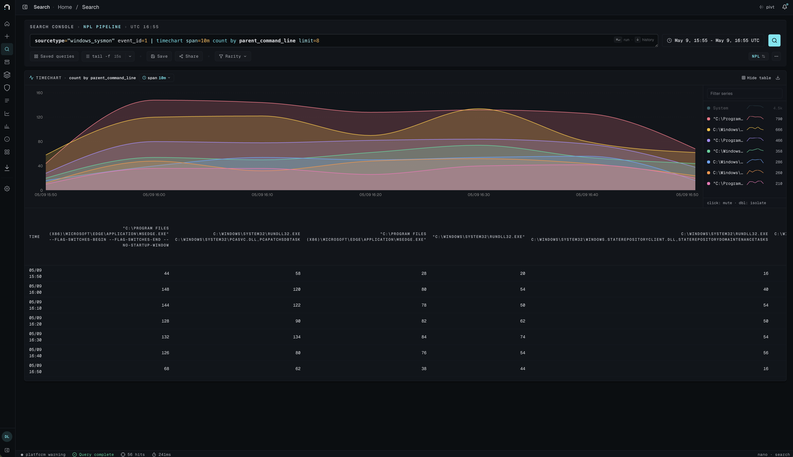
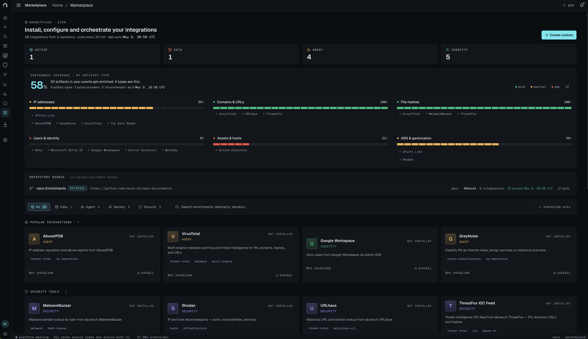

<p align="center">
  <picture>
    <source media="(prefers-color-scheme: dark)" srcset="./logo_white.svg">
    <source media="(prefers-color-scheme: light)" srcset="./logo_blue.svg">
    
  </picture>
</p>

<p align="center">
  A lightweight, opinionated SIEM. Search, detection, and triage for security
  analysts who want to ship signal — not babysit a data lake.
</p>

<p align="center">
  <a href="./LICENSE"></a>
  <a href="https://discord.gg/5rk8bwmkj7"></a>
</p>

<p align="center">
  <a href="https://nano.rs">Website</a>
  ·
  <a href="https://nano.rs/docs/getting-started/first-feed/">Docs</a>
  ·
  <a href="https://discord.gg/5rk8bwmkj7">Discord</a>
  ·
  <a href="https://nano.rs/pricing">Hosted</a>
</p>

<p align="center">
  
</p>

---

nano is built around a small set of beliefs:

- **OCSF 1.9 is the contract.** Events land as typed OCSF 1.9 Parquet on
  object storage, queried by an embedded chDB engine. Searches stay fast
  because the schema does the work, and no database cluster is required.
- **nPL beats SQL for hunting.** A piped query language (`error | stats count
  by src_ip | where count > 10`) keeps analyst muscle memory portable.
- **Detections have a lifecycle.** Rules move Staging → Live → Alerting. Match
  counts and signals are visible at every step.
- **Restraint over decoration.** 1px borders, 11–13px text, mono for IDs and
  timestamps. The UI is the same density a terminal user expects.

This repository is the open-core engine, licensed under **AGPL-3.0**. Hosted
plans, the pivt AI assistant, Cases, incidents, and risk scoring are
available from [nano.rs](https://nano.rs).

## Install

One command on any host with Docker:

```sh
curl -fsSL https://get.nano.rs | bash
```

<p align="center">
  <a href="https://youtu.be/cyL6lkPZfbw">
    
  </a>
</p>

<p align="center">
  <em>One command. 45 seconds. Working nano instance. <a href="https://youtu.be/cyL6lkPZfbw">▶ Watch on YouTube</a></em>
</p>

The installer clones this repo to `~/nano`, generates secrets, pulls the
prebuilt images from `ghcr.io/nano-rs`, verifies their digests against
[`images.lock`](./images.lock), brings up the lean OCSF 1.9 lake stack
(PostgreSQL + Dragonfly + RustFS object store + one single-tenant lake cell
with an embedded chDB engine + enrichment, telemetry, and bucket-drop
services + api/search/jobs/web + Vector + nginx), and walks you through
creating the first admin account. Open `http://localhost` when it finishes.

**Prereqs:** Docker with Compose v2.24 or newer, git, openssl, curl, python3.
Images are published for x86-64 and arm64.

**Minimum host:** at least 12 GiB of memory available to Docker (on Docker
Desktop that is the VM's memory setting, not the machine's RAM). The
installer refuses below that and sizes the lake cell's memory from what it
finds.

**Ports:** 80 (web UI and API through nginx), 8080 (HTTP ingest), 8088 (HEC),
and 8090 (enrichment ingress) listen on all interfaces. OTLP (4317/4318),
Vector native (6000), Fluent Forward (24224), and the object store
(9000/9001) bind to 127.0.0.1 only.

### Ingest: Vector, Tenzir, or both

The default install runs Vector (HTTP `/ingest`, HEC, OTLP, pull connectors)
**and** the OCSF bucket drop, where Tenzir writes OCSF 1.9 files straight into
the object store. For a Tenzir-only install without Vector:

```sh
curl -fsSL https://get.nano.rs | bash -s -- --tenzir
```

Re-running the installer keeps the mode an install already has;
`--add-vector` adds Vector to a Tenzir-only install. See
[`tenzir/AGENTS.md`](./tenzir/AGENTS.md) for writing Tenzir pipelines.

### Upgrading from the ClickHouse edition

The ClickHouse edition is retired and **cannot be upgraded in place**. Run
over a ClickHouse install, the installer stops before changing anything and
prints the steps: back up what you need, `docker compose down` the old stack
(its volumes are kept), and install the current edition into a new
directory. Nothing is migrated; the new install starts empty. The last
ClickHouse source is the `legacy/clickhouse` branch, unsupported.

For non-interactive installs, pre-set `NANO_ADMIN_EMAIL`,
`NANO_ADMIN_NAME`, `NANO_ADMIN_PASSWORD`, and `NANO_BASE_URL` before piping. See [`.env.opensource.example`](./.env.opensource.example) for
the full env-var surface.

### HTTPS / TLS

The default stack serves plain HTTP on port 80. To serve HTTPS, bring your
own certificate — drop a cert chain and private key into `config/nginx/ssl/`:

```
config/nginx/ssl/fullchain.pem   # certificate (leaf + intermediates)
config/nginx/ssl/privkey.pem     # private key
```

Get them however you like — Let's Encrypt/certbot, your own CA, or a
self-signed pair for testing (`./config/nginx/generate-ssl.sh`). Both `*.pem`
files are gitignored. Then bring the stack up with the TLS overlay:

```sh
docker compose -f docker-compose.opensource.yml -f docker-compose.tls.yml up -d
```

nginx serves HTTPS on :443 and redirects :80 → :443. Set `BASE_URL=https://your.domain`
in `.env` so login cookies get the `Secure` flag. Renew certs out of band and
`docker compose ... restart nginx` to pick them up. See
[`config/nginx/ssl/README.md`](./config/nginx/ssl/README.md) for details.

## Storage: the lake

Events are stored as OCSF 1.9 Parquet on a bundled RustFS object store and
queried by the lake cell's embedded chDB engine. There is no ClickHouse server. See
[docs/deployment/open-lean-install.md](./docs/deployment/open-lean-install.md)
for ingest modes, upgrades, backups and release notes.

> The retired ClickHouse edition (UDM + the ClickHouse `legacy` compose
> profile) lives on branch `legacy/clickhouse`, unsupported. Existing
> ClickHouse installs move by fresh install (see
> [Upgrading from the ClickHouse edition](#upgrading-from-the-clickhouse-edition)).

## What's in the box

- **Ingestion** — Vector-based collectors with VRL parsers (HTTP push, HEC,
  OTLP, syslog, S3 pull), and Tenzir writing OCSF files straight into the
  object store. Parser content is published separately under Apache-2.0.
- **Storage** — OCSF 1.9 Parquet on a bundled RustFS object store, run by a
  single-tenant lake cell; PostgreSQL for metadata.
- **Search** — nPL parser and compiler, executed by the lake cell's embedded
  chDB engine; field-stat sidebar.
- **Detection** — scheduled (cron) + real-time (five-second micro-batch) rules,
  findings logged back into the lake, prevalence-based noise reduction.
- **Alerts** — lifecycle (new → triaged → resolved), grouping, dedup.
- **Marketplace** — install + configure out-of-the-box enrichment
  providers (identity and geolocation in open core).
  Coverage indicator across OCSF fields.
- **Web UI** — React SPA, lazy-loaded, runs in any modern browser.

<p align="center">
  
</p>

<p align="center">
  <em>Detection rule editor — Staging → Live → Alerting lifecycle, MITRE ATT&amp;CK tagging, baseline impact, validation, and version history.</em>
</p>

<p align="center">
  
</p>

<p align="center">
  <em>Hunting in nPL — <code>sourcetype="windows_sysmon" event_id=1 | timechart span=10m count by parent_command_line limit=8</code>. Stacked per-series visualization, top-N split-by, results table inline.</em>
</p>

<p align="center">
  
</p>

<p align="center">
  <em>Marketplace — enrichment catalog (identity and geolocation in open core). Coverage indicator tracks which OCSF fields have a provider behind them.</em>
</p>

## Develop from source

The [Install](#install) flow above is the right path if you just want
to run nano. To hack on the engine itself:

- Prereqs: Rust stable, Node 20+, Docker
- `./install.sh` from this checkout brings up the lean stack
  (`COMPOSE_PROFILES=lean`) that the services run against
- `cd nanosiem-web && npm install && npm run dev` (port 5173)

See [CONTRIBUTING.md](./CONTRIBUTING.md) for the day-to-day dev workflow
and what env vars to override.

Full documentation: **[nano.rs/docs](https://nano.rs/docs/getting-started/first-feed/)**.

## Architecture

```
+------------+     +------------+     +------------------+
|  Vector    | --> | nanosiem-  | --> | RustFS object    |
|  parsers   |     | api  :3000 |     | store (OCSF 1.9  |
+------------+     +------------+     | Parquet)         |
                         |            +------------------+
                         v                     ^
                   +------------+     +--------+---------+
                   | PostgreSQL |     | lake cell:       |
                   | (rules,    |     | ingest, chDB     |
                   |  alerts,   |     | query, detect,   |
                   |  audit)    |     | compaction +     |
                   +------------+     | retention        |
                                      +------------------+
                                               ^
                                      +--------+---------+
                                      | nanosiem-search  |
                                      | :3002 <- web SPA |
                                      +------------------+
```

- `nanosiem-api` — rules, alerts, settings, ingestion, OpenAPI at `/swagger-ui`
- `nanosiem-search` — query execution, field stats, log fetch
- `nanosiem-jobs` — scheduled detection runner, repository sync
- `nanosiem-lake-cell` — the single-tenant lake cell: ingest, chDB query,
  detection windows, compaction, and retention for the object lake

## Documentation

- **[Getting Started](https://nano.rs/docs/getting-started/first-feed/)** —
  bring up nano and ingest your first feed
- **[Search Commands (nPL)](https://nano.rs/docs/search-commands/)** —
  pipe commands, eval functions, syntax reference
- **[Detection Authoring](https://nano.rs/docs/user-guide/detections/)** —
  write rules, manage lifecycle, tune for noise
- **[UDM Reference](https://nano.rs/docs/reference/udm-fields/)** — the
  legacy UDM field names, still accepted in nPL as aliases for OCSF fields
- **[Coding Agents](https://nano.rs/docs/coding-agents)** — manage
  searches, parsers, and detections via Claude Code / Codex pointed at
  your nano instance. The hosted plan ships an in-app AI assistant
  (pivt); coding-agents brings equivalent leverage to open-core
  deployments, locally.

## Ecosystem

The engine works on its own, but a small set of companion repos ships
the content layer most teams want on day one:

- **[nano-enrichments](https://github.com/nano-rs/nano-enrichments)** —
  threat-intel feeds, identity providers, and asset-inventory adapters
  wired into the in-app marketplace
- **[parsers](https://github.com/nano-rs/parsers)** — Vector + VRL
  parsers for common log sources (proxy, EDR, cloud audit, Windows)
- **[rules](https://github.com/nano-rs/rules)** — curated detection
  rules, importable into nano via the rule library
- **[nanodac](https://github.com/nano-rs/nanodac)** —
  detection-as-code: define rules in Git, sync to nano via GitOps
- **[models](https://github.com/nano-rs/models)** — LiteLLM model
  catalog backing pivt's AI features

nano ships no parsers or rules of its own. On first start, an install
registers `nano-rs/parsers` and `nano-rs/rules` on their `main` branches
(OCSF 1.9 content) and syncs them, so the full catalog is there at first login.
After that it checks them every hour. An upgraded install with those
repositories on the retired `ocsf-1.9` branch, or with auto-sync off, is moved
to `main` and starts following them with no action needed. Upstream updates refresh the catalog only: parsers and rules you
already imported are flagged for review and never overwritten. To stop following
a catalog, disable that repository (a deleted one is registered again on the
next start). Offline installs keep booting and show the
failed sync on the repository page. Air-gapped installs (`AIRGAP_MODE`) never
contact GitHub and take signed content bundles instead. Third-party repositories
default to `main`, and explicit branch pins are kept.

## What's open vs. hosted

This repository is the open-core engine — functionally complete for
ingestion, search, detection, and alerting. Some platform features ship
only in the hosted distribution at [nano.rs](https://nano.rs):

- **Cases** — investigation management, collaborative notebooks
- **Incidents** — multi-case orchestration, queue routing
- **pivt** — ambient AI assistant covering detection generation, rule
  tuning, query review, parser editing, and shadow investigation
- **Risk scoring** — entity-level risk across users, hosts, and cloud
  accounts
- **Auto-tuning** — AI-driven false-positive reduction

Self-hosting nano with these features requires a commercial license —
[hello@nano.rs](mailto:hello@nano.rs).

## Roadmap

- Public detection-rule library (community-contributed)
- OpenTelemetry log/trace ingestion
- Parser SDK for community-authored VRL parsers
- Saved-query API + CLI client
- See [open issues](https://github.com/nano-rs/nano/issues) for the
  active backlog

## Community

- **Star this repo** if nano is useful to you — it helps others find it
- **[Discord](https://discord.gg/5rk8bwmkj7)** — questions, design
  discussions, show-and-tell
- **[Good first issues](https://github.com/nano-rs/nano/issues?q=is%3Aissue+is%3Aopen+label%3A%22good+first+issue%22)** —
  curated entry points for new contributors
- **[Discussions](https://github.com/nano-rs/nano/discussions)** —
  longer-form Q&A and proposals

## Contributing

We accept community contributions under a CLA — see
[CONTRIBUTING.md](./CONTRIBUTING.md) and
[.github/ICLA.md](./.github/ICLA.md). DCO is not sufficient because nano is
open-core; the CLA grants Nano LLC the sublicensing right needed to keep
parts of the platform proprietary while still accepting your patches.

Bug reports and feature requests:
[issue templates](./.github/ISSUE_TEMPLATE/).

## Security

Found a vulnerability? Please don't open a public issue. See
[SECURITY.md](./SECURITY.md) — short version: email
[security@nano.rs](mailto:security@nano.rs) with a 90-day disclosure window.

## License

The engine in this repository is licensed under the GNU Affero General
Public License v3.0 or later. See [LICENSE](./LICENSE).

If AGPL doesn't fit your deployment, a commercial license is available —
get in touch at [hello@nano.rs](mailto:hello@nano.rs).
